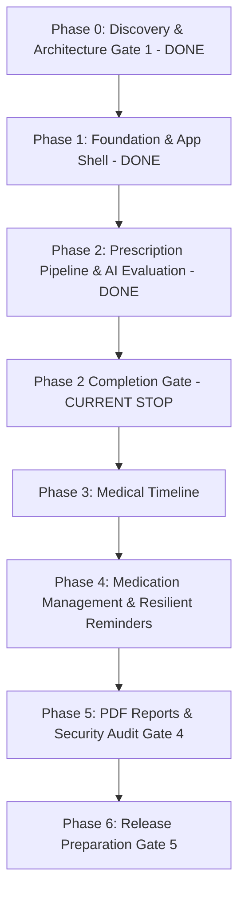

# Master Implementation Plan — My Health App

**Document Version:** 2.0.0  
**Last Updated:** 2026-10-12  
**Status:** Phase 2 Complete — Gated at Phase 2 Completion Review  

---

## 1. Roadmap Overview & Execution Strategy

The implementation follows a strict 7-phase model gated by explicit reviews. No code is merged into production without automated tests and verification.

---

## 2. Phase-by-Phase Milestone Plan

### Phase 0: Discovery and Planning (COMPLETED)
- **Status:** Done. Gate 1 approved with conditions.
- **Tasks:** `DISC-001` through `DISC-008` (8/8 Done).

---

### Phase 1: Application Foundation (COMPLETED)
- **Goal:** Establish a working, type-safe mobile shell and backend service with local Docker environment, configurable auth, design tokens, discrete occurrence scheduler, and database migrations.
- **Milestone Exit Gate:** Authenticated user can log in on mobile, retrieve their profile from the backend, and view the empty-state dashboard. All automated tests green.
- **Tasks:** `FOUND-001` through `FOUND-008` (8/8 Done).

---

### Phase 2: Prescription Pipeline & AI Evaluation (COMPLETED)
- **Goal:** Enable end-to-end prescription upload, AI processing, mandatory patient review, and verified record confirmation, backed by a benchmark dataset and mock provider.
- **Milestone Exit Gate:** Patient can capture or select a PDF, upload it privately, view extracted fields alongside the original image, edit/correct details, and confirm the record.
- **Tasks:**
  - `RX-001`: Mobile document capture & picker (Camera, photo gallery, PDF document picker) with size/MIME validation. (`DONE`)
  - `RX-002`: Private storage upload flow (pre-signed upload URLs, file checksums, magic byte validation, anti-tampering). (`DONE`)
  - `RX-003`: Asynchronous extraction-job lifecycle on backend (`ExtractionJobQueue` with status polling, state machine, and timeouts). (`DONE`)
  - `RX-004`: Server-side AI provider abstraction (`PrescriptionExtractionProvider`) with `MockPrescriptionExtractionProvider` and provider evaluation harness. (`DONE`)
  - `RX-005`: Indian prescription evaluation benchmark dataset (32 curated test documents covering cursive handwriting, Indian brand names, abbreviations, and discharge summaries). (`DONE`)
  - `RX-006`: Structured extraction validation with strict Zod schema (medicine name, dosage, frequency, duration, doctor, date, uncertainty flags). (`DONE`)
  - `RX-007`: Mobile document viewer with zoom/pan capabilities, page navigation, and pre-signed preview URLs. (`DONE`)
  - `RX-008`: Interactive prescription review screen with uncertainty flags, field editing, and missing value indicators. (`DONE`)
  - `RX-009`: Confirmation API to transform validated draft extractions into immutable `prescriptions`, `prescription_items`, and verified timeline events. (`DONE`)
  - `RX-010`: Error handling, bounded retry logic, and duplicate upload/request idempotency. (`DONE`)

---

### Phase 3: Medical Timeline (NEXT PHASE — GATED)
- **Tasks:** `TL-001` through `TL-007`.

### Phase 4: Medication Management & Resilient Reminders
- **Tasks:** `MED-001` through `MED-010`.

### Phase 5: Doctor-Ready PDF Reports & Security Audit
- **Tasks:** `REP-001` through `REP-003`, `SEC-001` through `SEC-005`.

### Phase 6: Release Preparation & Verification
- **Tasks:** `REL-001` through `REL-009`.
